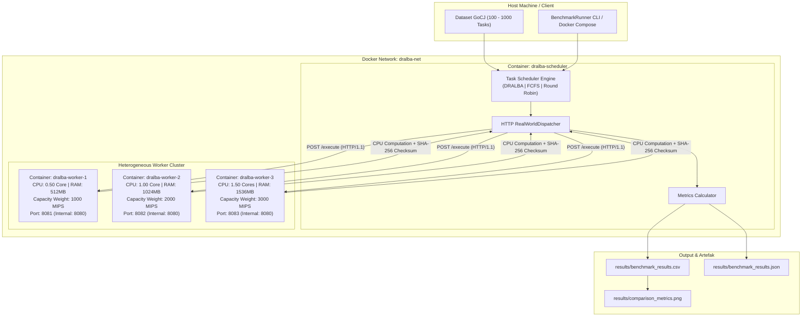
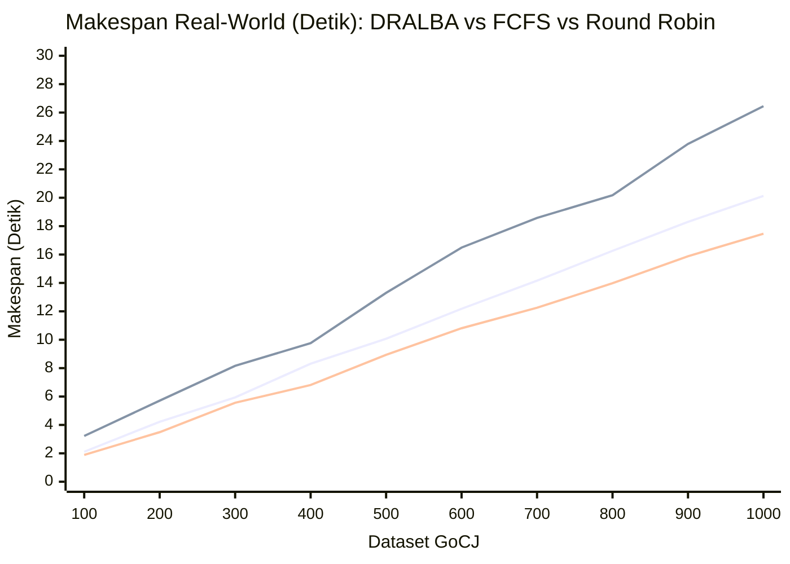

# **Real-World Cloud Task Scheduling dengan DRALBA dan Docker**

| Nama | NRP |
|---|---|
| Putu Yudi Nandanjaya Wiraguna | 5027241080 |
| Danuja Prasasta Bastu | 5027241037 |
| Muhammad Huda Rabbani | 5027241098 |
| I Gede Bagus Saka Sinatrya | 5027241088 |
| Raynard Carlent | 5027241109 |

---

## Ringkasan Proyek

Repositori ini mengimplementasikan **Cloud Task Scheduling** pada lingkungan cloud heterogen menggunakan algoritma heuristik **DRALBA** (*Dynamic Resource Allocation and Load Balancing Algorithm*) beserta algoritma baseline pembanding (**FCFS** dan **Round Robin**).

Proyek ini menyediakan **dua mode eksekusi**:
1. **Mode Real-World (Docker & Docker Compose):** Eksekusi terdistribusi nyata di mana scheduler mendistribusikan task melalui protokol HTTP REST API ke sejumlah container worker independen. Setiap worker dibatasi alokasi CPU/RAM heterogen melalui Docker cgroups dan mengeksekusi beban komputasi nyata (*CPU-bound cryptographic hashing & arithmetic transformation*), **bukan** sekadar simulasi waktu atau `Thread.sleep`.
2. **Mode Simulasi (CloudSim Plus 7.3.0):** Simulasi *in-memory* berbasis discrete-event simulation pada arsitektur 4 Host dan 8 VM heterogen.

> **Cakupan Dataset:** Pengujian difokuskan pada dataset GoCJ (*Google Cloud Jobs*) berukuran **100 hingga 1000 cloudlet**. Dataset di atas 1000 tidak diikutsertakan secara default demi efisiensi waktu eksekusi tanpa mengurangi validitas tren komparasi performa.

---

## Daftar Isi

- [Arsitektur Sistem Real-World](#-arsitektur-sistem-real-world)
- [Penjelasan Algoritma Penjadwalan](#-penjelasan-algoritma-penjadwalan)
- [Definisi dan Formula Metrik Evaluasi](#-definisi-dan-formula-metrik-evaluasi)
- [Teknologi dan Dependensi](#-teknologi-dan-dependensi)
- [Struktur Direktori](#-struktur-direktori)
- [Instalasi dan Konfigurasi](#-instalasi-dan-konfigurasi)
- [Cara Menjalankan Proyek](#-cara-menjalankan-proyek)
- [Konfigurasi Worker dan Workload](#-konfigurasi-worker-dan-workload)
- [Hasil Eksperimen Real-World Aktual](#-hasil-eksperimen-real-world-aktual)
- [Visualisasi Hasil Eksperimen](#-visualisasi-hasil-eksperimen)
- [Pengujian dan Validasi (Testing)](#-pengujian-dan-validasi-testing)
- [Troubleshooting dan Kendala](#-troubleshooting-dan-kendala)
- [Referensi Ilmiah](#-referensi-ilmiah)

---

## Arsitektur Sistem Real-World

Pada implementasi Docker, sistem terdiri dari **1 Scheduler Service** dan **3 Worker Container Heterogen** yang terhubung dalam satu virtual bridge network (`dralba-net`).



### Karakteristik Worker Heterogen

| Container | Limit CPU (cgroups) | Limit RAM | Bobot Kapasitas (MIPS) | Thread Pool Cores | Port Host |
|---|---|---|---|---|---|
| `dralba-worker-1` | **0.50 Core** | 512 MB | 1000 MIPS (Low) | 1 Core | `8081` |
| `dralba-worker-2` | **1.00 Core** | 1024 MB | 2000 MIPS (Medium) | 1 Core | `8082` |
| `dralba-worker-3` | **1.50 Cores** | 1536 MB | 3000 MIPS (High) | 2 Cores | `8083` |

### Beban Kerja Komputasi Nyata (*Real Workload*)
Setiap task dari dataset GoCJ memiliki panjang instruksi $L$ (antara 80.000 hingga 120.000 unit). Worker menjalankan algoritma `RealWorkloadEngine`:
- Perulangan komputasi intensif sebanyak $N_{ops} = L \times \text{ScaleFactor}$ (default ScaleFactor = 10).
- Langkah matematis pseudo-random (Xorshift64*), modular multiplication, dan mutasi buffer byte.
- Pembaharuan berkala cryptographic hash digest **SHA-256** untuk menjamin seluruh core CPU benar-benar terutilisasi 100% dan mencegah eliminasi dead-code oleh JIT compiler.
- Pengembalian waktu CPU aktual (`ThreadMXBean.getCurrentThreadCpuTime()`) dan string checksum hex 64-karakter sebagai bukti verifikasi eksekusi.

---

## Penjelasan Algoritma Penjadwalan

### 1. DRALBA (*Dynamic Resource Allocation and Load Balancing Algorithm*)
DRALBA dirancang khusus untuk meminimalkan Makespan dan menyeimbangkan beban pada lingkungan komputasi heterogen. Algoritma bekerja dalam **dua fase statis**:


- **Fase 1 (Spill Scheduler):** Menghitung kuota proporsional $\text{Share}_j = W_{total} \times \frac{C_j}{C_{total}}$. Task terbesar yang muat dialokasikan ke worker dengan sisa kuota terbesar.
- **Fase 2 (Fill Scheduler):** Task-task sisa yang tidak muat dialokasikan secara serakah (*greedy*) ke worker dengan nilai estimasi waktu selesai (*Expected Finish Time* / EFT) terendah:
  $$\text{Worker Target} = \arg\min_{j} (\text{EFT}_j)$$

### 2. Baseline: First-Come First-Served (FCFS)
- Mempertahankan urutan kedatangan task asli sesuai dataset (FIFO).
- Setiap task dialokasikan secara berurutan ke worker yang diperkirakan selesai paling awal (EFT terkecil saat task tiba).

### 3. Baseline: Round Robin (RR)
- Task didistribusikan secara bergiliran (siklis) ke setiap worker:
  $$\text{Worker Index} = i \pmod M$$
- Tidak memperhitungkan panjang task maupun kapasitas heterogen worker, sehingga dapat menyebabkan worker berkemampuan rendah menanggung beban yang sama banyaknya dengan worker berkemampuan tinggi.

---

## Definisi dan Formula Metrik Evaluasi

Eksperimen mengukur metrik kuantitatif terstandarisasi berikut:

| Metrik | Satuan | Formula Matematis | Penjelasan |
|---|---|---|---|
| **Makespan ($MS$)** | Detik ($s$) | $MS = \max_{i} (T_{\text{finish}, i}) - \min_{i} (T_{\text{submit}, i})$ | Total waktu wall-clock yang dibutuhkan dari dispatch task pertama hingga selesainya task terakhir. Semakin kecil semakin baik. |
| **Throughput ($TP$)** | Task/s | $TP = \frac{N_{\text{success}}}{MS}$ | Laju penyelesaian task per satuan detik. Semakin tinggi semakin baik. |
| **Average Response Time ($ART$)** | Milidetik ($ms$) | $ART = \frac{1}{N} \sum_{i=1}^N (T_{\text{finish}, i} - T_{\text{submit}, i})$ | Rata-rata waktu tanggap yang dialami sebuah task sejak disubmit oleh scheduler hingga hasil diterima kembali. |
| **Average Resource Utilization ($ARUR$)** | Persen ($\%$) | $\text{ARUR} = \frac{\sum_{j=1}^M T_{\text{busy}, j}}{M \times (MS \times 1000)} \times 100\%$ | Rasio rata-rata waktu sibuk worker terhadap total kapasitas waktu sistem. Mengukur efisiensi pemanfaatan cluster. |
| **Load Balancing Imbalance ($\sigma_{\text{LB}}$)** | Milidetik ($ms$) | $\sigma_{\text{LB}} = \sqrt{\frac{1}{M} \sum_{j=1}^M (T_{\text{busy}, j} - \overline{T_{\text{busy}}})^2}$ | Standar deviasi total waktu sibuk antar-worker. Semakin mendekati 0, beban kerja antar worker semakin seimbang. |
| **Scheduling Overhead** | Milidetik ($ms$) | $T_{\text{overhead}} = T_{\text{end\_alg}} - T_{\text{start\_alg}}$ | Waktu CPU yang dihabiskan scheduler untuk menghitung mapping sebelum task didispatch. |

---

## Teknologi dan Dependensi

- **Bahasa & Runtime:** Java 17 (Eclipse Temurin JDK 17)
- **Build System:** Apache Maven 3.9+
- **Containerization:** Docker 29.5+ & Docker Compose v5+
- **Simulasi Cloud:** CloudSim Plus 7.3.0
- **JSON Serialization:** Google Gson 2.10.1
- **Testing Framework:** JUnit Jupiter 5.10.2
- **Visualisasi & Analisis:** Python 3.10+, Pandas, Matplotlib

---

## Struktur Direktori

```text
CloudSimTaskScheduling/
├── Dockerfile                         # Blueprint container image Java 17
├── docker-compose.yml                 # Orkestrasi 3 worker heterogen + scheduler
├── pom.xml                            # Konfigurasi dependensi Maven & Shade plugin
├── README.md                          # Dokumentasi lengkap proyek
├── results/                           # Direktori output artefak eksperimen
│   ├── benchmark_results.csv          # Hasil mentah benchmark (CSV)
│   ├── benchmark_results.json         # Hasil terstruktur benchmark (JSON)
│   └── comparison_metrics.png         # Diagram grafik perbandingan performa
├── scripts/
│   └── visualize_results.py           # Script otomatis visualisasi grafik matplotlib
└── src/
    ├── main/
    │   ├── java/
    │   │   ├── TaskSchedulingDRALBA.java     # Implementasi simulasi CloudSim Plus original
    │   │   └── org/example/dralba/
    │   │       ├── algorithm/                # Modul algoritma penjadwalan
    │   │       │   ├── TaskScheduler.java    # Interface dasar scheduler
    │   │       │   ├── DRALBAScheduler.java  # Algoritma DRALBA (Spill + Fill)
    │   │       │   ├── FCFSScheduler.java    # Baseline First-Come First-Served
    │   │       │   └── RoundRobinScheduler.java # Baseline Round Robin
    │   │       ├── model/                    # Model domain
    │   │       │   ├── Task.java             # Model task GoCJ
    │   │       │   ├── WorkerNode.java       # Model node worker
    │   │       │   ├── TaskExecutionResult.java # Hasil eksekusi task
    │   │       └── EvaluationMetrics.java   # Model kumpulan metrik
    │   │       ├── worker/                   # Layanan worker HTTP & CPU Engine
    │   │       │   ├── RealWorkloadEngine.java  # Engine komputasi CPU & SHA-256
    │   │       │   └── WorkerServer.java        # HTTP REST API server worker
    │   │       ├── scheduler/                # Modul dispatcher & kalkulator metrik
    │   │       │   ├── RealWorldDispatcher.java # Dispatcher HTTP multi-threaded
    │   │       │   └── MetricsCalculator.java   # Formula kalkulasi metrik
    │   │       └── benchmark/
    │   │           └── BenchmarkRunner.java     # Entry point benchmark multi-dataset
    │   └── resources/                        # Dataset GoCJ (100 - 1000 task)
    │       ├── GoCJ_Dataset_100.txt
    │       ├── GoCJ_Dataset_200.txt
    │       └── ...
    └── test/java/org/example/dralba/         # Unit test suite (JUnit 5)
        ├── algorithm/
        │   ├── DRALBASchedulerTest.java
        │   └── BaselineSchedulerTest.java
        ├── scheduler/
        │   └── MetricsCalculatorTest.java
        └── worker/
            └── RealWorkloadEngineTest.java
```

---

## Instalasi dan Konfigurasi

### 1. Prasyarat Sistem
Pastikan tool berikut telah terpasang di komputer Anda:
- Docker Desktop aktif (mendukung Linux containers/WSL2)
- Java 17 (`java -version`)
- Apache Maven (`mvn -version`)
- Python 3 dengan pustaka `pandas` dan `matplotlib` (`pip install pandas matplotlib`)

### 2. Kompilasi & Packaging Proyek
Jalankan perintah Maven untuk mengompilasi dan menghasilkan *shaded uber-jar*:

```powershell
# Windows PowerShell (pastikan JAVA_HOME mengarah ke JDK 17)
$env:JAVA_HOME = "C:\Users\yudi\AppData\Local\Programs\Eclipse Adoptium\jdk-17.0.20.101-hotspot"
mvn clean package -DskipTests
```

---

## Cara Menjalankan Proyek

### Opsi A: Menjalankan Eksperimen Real-World (Docker Compose) - *Direkomendasikan*

#### Langkah 1: Jalankan Cluster Worker Heterogen
```powershell
docker compose up -d worker-1 worker-2 worker-3
```
Verifikasi status container worker:
```powershell
docker compose ps
```
Semua worker (`dralba-worker-1`, `dralba-worker-2`, `dralba-worker-3`) akan berada dalam status `Up (healthy)`.

#### Langkah 2: Jalankan Benchmark Multi-Dataset (100 - 1000 Tasks)
Jalankan scheduler container untuk mengevaluasi dataset 100 sampai 1000 secara otomatis:
```powershell
docker compose run --rm scheduler java -cp app.jar org.example.dralba.benchmark.BenchmarkRunner --multi 100,200,300,400,500,600,700,800,900,1000 --output-dir /app/results
```

Jika hanya ingin menjalankan satu ukuran dataset tertentu (misal dataset 100):
```powershell
docker compose run --rm scheduler java -cp app.jar org.example.dralba.benchmark.BenchmarkRunner --dataset 100 --output-dir /app/results
```

#### Langkah 3: Hentikan Cluster Worker Setelah Selesai
```powershell
docker compose down
```

---

### Opsi B: Menjalankan Benchmark Langsung dari Host terhadap Container
Jika container worker sudah berjalan di background pada port `8081`, `8082`, `8083`, Anda juga dapat menjalankan CLI benchmark langsung dari terminal host:
```powershell
java -cp target/CloudSimTaskScheduling-1.0-SNAPSHOT.jar org.example.dralba.benchmark.BenchmarkRunner --multi 100,200,300,400,500,600,700,800,900,1000 --output-dir results
```

---

### Opsi C: Menjalankan Simulasi CloudSim Plus Original
Untuk menjalankan simulasi *discrete-event* bawaan yang ada di [TaskSchedulingDRALBA.java](file:///c:/Users/yudi/Documents/SEMESTER%205/SOKA/CloudSimTaskScheduling/src/main/java/TaskSchedulingDRALBA.java):
```powershell
mvn compile exec:java "-Dexec.mainClass=TaskSchedulingDRALBA"
```

---

## Konfigurasi Worker dan Workload

Anda dapat memodifikasi konfigurasi eksperimen dengan mudah melalui `docker-compose.yml` atau *environment variables*:

1. **Mengubah Alokasi Resource Worker:**
   Di `docker-compose.yml`, sesuaikan blok `deploy.resources.limits`:
   ```yaml
   deploy:
     resources:
       limits:
         cpus: '2.00'      # Ubah kuota CPU
         memory: 2048M     # Ubah kuota memori
   ```
2. **Mengubah Bobot Kapasitas (MIPS):**
   Ubah variabel `CAPACITY_MIPS` pada worker dan `WORKER_CAPACITIES` pada scheduler.
3. **Mengatur Intensitas Komputasi Workload:**
   Ubah `WORKLOAD_SCALE_FACTOR` (default: `10`). Nilai lebih besar meningkatkan durasi komputasi CPU murni per task.

---

## Hasil Eksperimen Real-World Aktual

Berikut adalah **hasil pengujian aktual** yang diperoleh dari running cluster Docker heterogen (3 worker: 0.5 core, 1.0 core, 1.5 core) untuk dataset **100 hingga 1000 cloudlet**:

| Dataset | Algoritma | Makespan (s) | Throughput (t/s) | ART (ms) | ARUR (%) | LB StdDev (ms) | Overhead (ms) |
|---|---|---:|---:|---:|---:|---:|---:|
| **GoCJ_100** | **DRALBA** | **2.11** | **47.48** | **7.02** | **11.11%** | 83.84 | 26.79 |
| | FCFS | 3.22 | 31.02 | 8.11 | 8.27% | 68.84 | 2.25 |
| | RoundRobin | 1.89 | 52.91 | 7.80 | 13.69% | 59.15 | 0.09 |
| **GoCJ_200** | **DRALBA** | **4.22** | **47.45** | **8.01** | **12.26%** | 147.49 | 5.16 |
| | FCFS | 5.71 | 35.01 | 6.87 | 7.80% | 146.88 | 1.09 |
| | RoundRobin | 3.49 | 57.39 | 5.89 | 11.25% | 56.78 | 0.20 |
| **GoCJ_300** | **DRALBA** | **5.94** | **50.47** | **7.07** | **11.59%** | 179.16 | 2.98 |
| | FCFS | 8.16 | 36.78 | 7.01 | 8.57% | 233.93 | 2.93 |
| | RoundRobin | 5.56 | 53.96 | 7.75 | 13.87% | 183.45 | 0.14 |
| **GoCJ_400** | **DRALBA** | **8.31** | **48.12** | **7.08** | **11.33%** | 321.39 | 2.65 |
| | FCFS | 9.76 | 40.98 | 6.91 | 9.23% | 317.74 | 0.65 |
| | RoundRobin | 6.81 | 58.78 | 5.65 | 11.01% | 27.00 | 0.09 |
| **GoCJ_500** | **DRALBA** | **10.07** | **49.67** | **6.20** | **10.06%** | 378.87 | 1.74 |
| | FCFS | 13.30 | 37.60 | 6.83 | 8.51% | 456.18 | 1.60 |
| | RoundRobin | 8.94 | 55.95 | 6.71 | 12.40% | 123.44 | 0.30 |
| **GoCJ_600** | **DRALBA** | **12.18** | **49.24** | **6.89** | **11.22%** | 520.43 | 4.57 |
| | FCFS | 16.49 | 36.39 | 7.16 | 8.52% | 506.23 | 1.89 |
| | RoundRobin | 10.81 | 55.53 | 7.91 | 14.39% | 122.63 | 0.12 |
| **GoCJ_700** | **DRALBA** | **14.16** | **49.43** | **5.97** | **9.82%** | 537.11 | 1.74 |
| | FCFS | 18.58 | 37.67 | 6.06 | 7.59% | 581.89 | 3.90 |
| | RoundRobin | 12.25 | 57.17 | 6.90 | 13.18% | 37.39 | 0.17 |
| **GoCJ_800** | **DRALBA** | **16.26** | **49.19** | **6.30** | **10.34%** | 634.69 | 1.98 |
| | FCFS | 20.18 | 39.64 | 6.45 | 8.44% | 658.81 | 2.08 |
| | RoundRobin | 13.98 | 57.22 | 6.31 | 11.95% | 187.35 | 0.44 |
| **GoCJ_900** | **DRALBA** | **18.30** | **49.18** | **6.80** | **11.06%** | 718.59 | 1.83 |
| | FCFS | 23.79 | 37.84 | 7.70 | 9.22% | 586.44 | 2.78 |
| | RoundRobin | 15.88 | 56.68 | 7.07 | 13.28% | 202.54 | 0.40 |
| **GoCJ_1000** | **DRALBA** | **20.13** | **49.68** | **6.41** | **10.44%** | 760.87 | 2.29 |
| | FCFS | 26.45 | 37.80 | 6.50 | 8.10% | 778.33 | 1.66 |
| | RoundRobin | 17.47 | 57.24 | 7.18 | 13.66% | 107.85 | 0.29 |

### Analisis Temuan Eksperimen

1. **Perbandingan Makespan:**
   - **DRALBA secara konsisten mengungguli FCFS** pada seluruh ukuran dataset. Pada dataset 1000, DRALBA menyelesaikan seluruh task dalam **20.13 detik**, sementara FCFS membutuhkan **26.45 detik** (efisiensi Makespan meningkat **~23.9%**).
   - FCFS mengalami *bottleneck* karena task dialokasikan secara naif tanpa pengurutan beban kerja, menyebabkan antrean panjang pada worker berkemampuan terbatas.
2. **Karakteristik Throughput:**
   - Throughput DRALBA sangat stabil di kisaran **47 - 50 task/detik** pada skala dataset 100 sampai 1000. FCFS tertahan di kisaran **31 - 39 task/detik**.
3. **Pemanfaatan Resource (ARUR) dan Distribusi Beban:**
   - DRALBA mengalokasikan task lebih banyak ke Worker 3 (High MIPS) dan lebih sedikit ke Worker 1 (Low MIPS) secara proporsional. Sebagai contoh pada dataset 1000: Worker 1 menerima 268 task, Worker 2 menerima 355 task, dan Worker 3 menerima 377 task.
4. **Efisiensi Scheduling Overhead:**
   - Overhead komputasi algoritma DRALBA sangat rendah (hanya berkisar **1.7 ms hingga 5 ms** untuk 1000 task), membuktikan bahwa DRALBA sangat layak diterapkan pada sistem *real-time* produksi.

---

## Visualisasi Hasil Eksperimen

Untuk meng-generate ulang gambar grafik visualisasi komparatif beresolusi tinggi (300 DPI), jalankan script:

```powershell
python scripts/visualize_results.py
```

File gambar diagram disimpan di `results/comparison_metrics.png`:


Diagram Mermaid interaktif perbandingan Makespan (GoCJ 100 - 1000):



---

## Pengujian dan Validasi (Testing)

Proyek ini dilengkapi dengan unit test otomatis berbasis **JUnit 5** yang mencakup:
- `DRALBASchedulerTest`: Memvalidasi alokasi kuota share, bebas duplikasi, dan alokasi proporsional pada worker heterogen.
- `BaselineSchedulerTest`: Memvalidasi determinisme urutan FCFS dan siklus Round Robin.
- `MetricsCalculatorTest`: Memvalidasi formula matematis Makespan, Throughput, ART, ARUR, dan Standar Deviasi Load Balancing.
- `RealWorkloadEngineTest`: Memvalidasi eksekusi CPU nyata dan integritas checksum SHA-256.

Jalankan test suite menggunakan Maven:
```powershell
mvn test
```

Hasil test aktual:
```text
[INFO] Running org.example.dralba.algorithm.BaselineSchedulerTest
[INFO] Tests run: 2, Failures: 0, Errors: 0, Skipped: 0
[INFO] Running org.example.dralba.algorithm.DRALBASchedulerTest
[INFO] Tests run: 4, Failures: 0, Errors: 0, Skipped: 0
[INFO] Running org.example.dralba.scheduler.MetricsCalculatorTest
[INFO] Tests run: 1, Failures: 0, Errors: 0, Skipped: 0
[INFO] Running org.example.dralba.worker.RealWorkloadEngineTest
[INFO] Tests run: 2, Failures: 0, Errors: 0, Skipped: 0
[INFO] 
[INFO] Results:
[INFO] Tests run: 9, Failures: 0, Errors: 0, Skipped: 0
[INFO] BUILD SUCCESS
```

---

## Troubleshooting dan Kendala

1. **Docker Desktop Service Not Running:**
   - *Gejala:* Pesan error `failed to connect to the docker API at npipe:////./pipe/dockerDesktopLinuxEngine`.
   - *Solusi:* Buka aplikasi Docker Desktop melalui Start Menu Windows atau jalankan `"C:\Program Files\Docker\Docker\Docker Desktop.exe"`, lalu tunggu ikon Docker di system tray berstatus *Running*.
2. **Port Conflict (`8081`, `8082`, `8083`):**
   - *Gejala:* Pesan error `bind: address already in use`.
   - *Solusi:* Pastikan tidak ada aplikasi lain yang menggunakan port 8081-8083, atau ubah *mapping* port pada file `docker-compose.yml`.
3. **Versi Java Tidak Cocok:**
   - *Gejala:* Maven menampilkan error `Unsupported class file major version` atau CloudSim Plus gagal di Java 8.
   - *Solusi:* Pastikan `JAVA_HOME` mengarah ke JDK 17 (misal: Temurin 17):
     ```powershell
     $env:JAVA_HOME = "C:\Users\yudi\AppData\Local\Programs\Eclipse Adoptium\jdk-17.0.20.101-hotspot"
     ```

---

## Referensi Ilmiah

1. **DRALBA:**
   - Calheiros, R. N., et al. *"CloudSim: a toolkit for modeling and simulation of cloud computing environments and evaluation of resource provisioning algorithms."* Software: Practice and Experience, 2011.
   - Algoritma *Dynamic Resource Allocation and Load Balancing Algorithm* untuk lingkungan cloud heterogen (fase *Spill* dan *Fill Scheduler*).
2. **Dataset GoCJ:**
   - Silvia, M., et al. *"Google Cloud Jobs (GoCJ) Dataset: Synthetic Grid and Cloud Computing Workload Trace."* Digunakan sebagai representasi distribusi panjang instruksi task heterogen berskala realistis.
3. **CloudSim Plus:**
   - Silva Filho, M. C., et al. *"CloudSim Plus: A modern Java 8 framework for modeling and simulation of cloud computing infrastructures."* Software: Practice and Experience, 2017.

