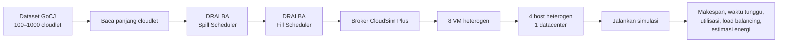
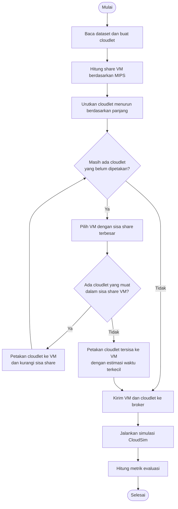
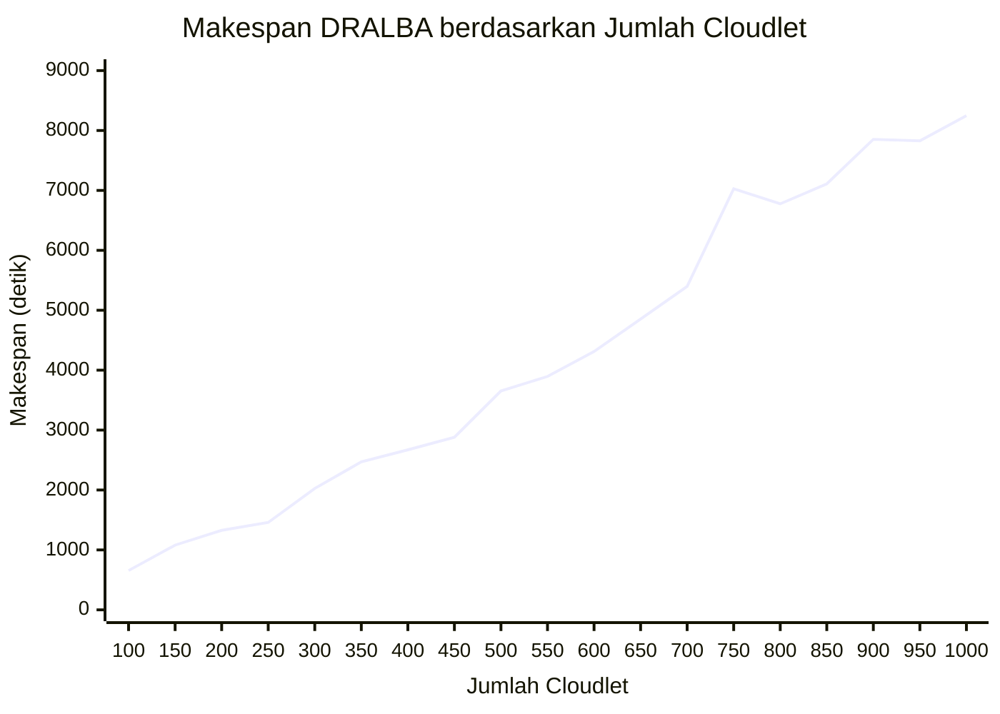

# **DRALBA Task Scheduling with CloudSim Plus**


| Nama                          | NRP        |
|-------------------------------|------------|
| Putu Yudi Nandanjaya Wiraguna | 5027241080 |
| Danuja Prasasta Bastu | 5027241037 |
| Muhammad Huda Rabbani | 5027241098 |
| I Gede Bagus Saka Sinatrya | 5027241088 |
| Raynard Carlent | 5027241109 |


Simulasi penjadwalan cloudlet pada infrastruktur cloud heterogen menggunakan algoritma **DRALBA** dan **CloudSim Plus**. Program membaca panjang cloudlet dari dataset GoCJ, memetakan cloudlet ke VM menggunakan dua fase penjadwalan, menjalankan simulasi, dan menghitung sejumlah metrik performa.

> **Cakupan eksperimen:** dataset yang digunakan adalah 100 sampai 1000 cloudlet, dengan interval 50. Dataset di atas 1000 tidak digunakan karena waktu running lebih lama. Angka hasil yang dicantumkan di README ini berasal dari satu kali running per dataset.

## Daftar Isi

- [Latar Belakang](#latar-belakang)
- [Tujuan](#tujuan)
- [Arsitektur Simulasi](#arsitektur-simulasi)
- [Algoritma DRALBA](#algoritma-dralba)
- [Dataset](#dataset)
- [Teknologi dan Persyaratan](#teknologi-dan-persyaratan)
- [Struktur Proyek](#struktur-proyek)
- [Menjalankan Simulasi](#menjalankan-simulasi)
- [Konfigurasi Eksperimen](#konfigurasi-eksperimen)
- [Hasil Eksperimen](#hasil-eksperimen)
- [Definisi Metrik](#definisi-metrik)
- [Batasan](#batasan)

## Latar Belakang

Penjadwalan cloudlet adalah proses menentukan VM yang akan menjalankan setiap task pada datacenter. Pada lingkungan heterogen, VM memiliki kapasitas pemrosesan dan memori yang berbeda. Karena itu, pembagian task perlu mempertimbangkan ukuran task serta kemampuan VM.

Proyek ini mengimplementasikan pendekatan DRALBA pada CloudSim Plus. Evaluasi difokuskan pada perubahan hasil ketika jumlah task dalam dataset bertambah. Eksperimen ini **bukan** benchmark komparatif terhadap algoritma penjadwalan lainnya.

## Tujuan

- Mengimplementasikan penjadwalan DRALBA untuk cloudlet pada VM heterogen.
- Menjalankan dataset berukuran 100–1000 cloudlet dengan interval 50.
- Mengamati makespan dan metrik performa lain pada setiap ukuran dataset.
- Membatasi cakupan eksperimen pada ukuran yang praktis untuk dijalankan.

## Arsitektur Simulasi



### Lingkungan cloud yang disimulasikan

Semua host berada dalam satu datacenter. Setiap processing element (PE) host dikonfigurasi dengan kapasitas 4000 MIPS.

| Host | Jumlah PE | RAM (MB) | Storage | Bandwidth |
|---|---:|---:|---:|---:|
| Host 1 | 4 | 8192 | 500000 | 10000 |
| Host 2 | 8 | 16384 | 1000000 | 10000 |
| Host 3 | 4 | 16384 | 1000000 | 10000 |
| Host 4 | 8 | 32768 | 2000000 | 10000 |

Daftar VM yang dikirimkan ke broker:

| VM | MIPS | Jumlah vCPU | RAM (MB) |
|---|---:|---:|---:|
| VM 1 | 1000 | 1 | 2048 |
| VM 2 | 1000 | 1 | 2048 |
| VM 3 | 2000 | 2 | 4096 |
| VM 4 | 3000 | 2 | 8192 |
| VM 5 | 2500 | 2 | 4096 |
| VM 6 | 4000 | 4 | 8192 |
| VM 7 | 4000 | 4 | 8192 |
| VM 8 | 4000 | 4 | 8192 |

## Algoritma DRALBA

Pada implementasi ini, penjadwalan dilakukan secara statis sebelum simulasi dimulai:

1. Hitung total panjang cloudlet dan total MIPS seluruh VM.
2. Alokasikan *share* panjang task untuk tiap VM secara proporsional terhadap MIPS VM.
3. Urutkan cloudlet dari panjang terbesar ke terkecil.
4. **Spill Scheduler:** pilih VM dengan sisa *share* terbesar, lalu alokasikan cloudlet pertama dalam urutan yang muat pada sisa *share* VM tersebut. Kurangi sisa *share* setelah alokasi.
5. **Fill Scheduler:** jika masih ada cloudlet yang belum teralokasi, tempatkan cloudlet tersebut ke VM dengan estimasi waktu kerja terakumulasi terkecil.
6. Kirim daftar cloudlet dan VM ke broker, lalu jalankan simulasi CloudSim.
7. Hitung metrik berdasarkan cloudlet yang selesai dan waktu kerja VM.



## Dataset

File dataset berada di `src/main/resources/`. Setiap baris berisi satu nilai panjang cloudlet yang dibaca sebagai bilangan bulat dan digunakan untuk membuat satu `CloudletSimple`.

| Atribut | Keterangan |
|---|---|
| Sumber file | `src/main/resources/GoCJ_Dataset_<jumlah>.txt` |
| Ukuran yang dievaluasi | 100, 150, 200, ..., 950, 1000 cloudlet |
| Jumlah file dalam cakupan | 19 |
| Format | Satu panjang cloudlet per baris |
| Ukuran di atas 1000 | Tidak digunakan pada eksperimen ini |

## Teknologi dan Persyaratan

- Java Development Kit (JDK) 17
- Apache Maven
- CloudSim Plus 7.3.0 (dikelola sebagai dependency Maven)

## Struktur Proyek

```text
CloudSimTaskScheduling/
├── pom.xml
├── README.md
└── src/
    └── main/
        ├── java/
        │   ├── TaskSchedulingDRALBA.java
        │   └── org/example/Main.java
        └── resources/
            ├── GoCJ_Dataset_100.txt
            ├── GoCJ_Dataset_150.txt
            ├── ...
            └── GoCJ_Dataset_1000.txt
```

`TaskSchedulingDRALBA.java` berisi konfigurasi datacenter, VM, pemuatan dataset, implementasi penjadwalan, eksekusi simulasi, dan perhitungan metrik. `org/example/Main.java` adalah kelas contoh sederhana dan bukan entry point simulasi DRALBA.

## Menjalankan Simulasi

### 1. Pastikan Java dan Maven tersedia

Periksa bahwa JDK 17 dan Maven telah terpasang serta dapat dipanggil dari terminal:

```powershell
java -version
mvn -version
```

### 2. Pilih dataset

Secara default, program menggunakan dataset 500 cloudlet. Untuk memilih ukuran lain, ubah nilai `datasetPath` di `src/main/java/TaskSchedulingDRALBA.java`, misalnya:

```java
String datasetPath = "src/main/resources/GoCJ_Dataset_500.txt";
```

Gunakan nama file yang tersedia pada `src/main/resources/`.

### 3. Jalankan simulasi

Dari direktori utama proyek, jalankan:

```powershell
mvn clean compile exec:java "-Dexec.mainClass=TaskSchedulingDRALBA"
```

Di akhir output, program menampilkan makespan, rata-rata waktu tunggu, utilisasi resource, standar deviasi load balancing, dan estimasi konsumsi energi.

> Mengubah dataset hanya mengganti input task. Konfigurasi datacenter dan VM pada source code tetap sama.

## Konfigurasi Eksperimen

| Parameter | Nilai |
|---|---|
| Simulator | CloudSim Plus 7.3.0 |
| Algoritma | DRALBA: Spill Scheduler dilanjutkan Fill Scheduler |
| Jumlah datacenter | 1 |
| Jumlah host | 4 host heterogen |
| Jumlah VM | 8 VM heterogen |
| Ukuran dataset | 100–1000 cloudlet |
| Interval ukuran dataset | 50 cloudlet |
| Jumlah running per ukuran | 1 |
| Metrik utama diagram | Makespan (detik simulasi) |

## Hasil Eksperimen

Grafik membandingkan **makespan hasil tiap ukuran dataset** dengan konfigurasi datacenter dan VM yang sama. Sumbu horizontal adalah jumlah cloudlet; sumbu vertikal adalah makespan dalam detik simulasi.



### Rincian hasil setiap running

| Dataset (cloudlet) | Makespan (detik) | Rata-rata waktu tunggu (detik) | Utilisasi resource (%) | Load balancing (StdDev) | Estimasi energi (kWh) |
|---:|---:|---:|---:|---:|---:|
| 100 | 655.34 | 0.00 | 60.86 | 154.78 | 0.182039 |
| 150 | 1080.11 | 0.00 | 56.53 | 290.07 | 0.300031 |
| 200 | 1326.94 | 0.00 | 53.72 | 373.15 | 0.368595 |
| 250 | 1458.16 | 0.00 | 54.10 | 409.24 | 0.405044 |
| 300 | 2026.20 | 0.00 | 52.72 | 593.74 | 0.562833 |
| 350 | 2469.66 | 0.00 | 50.81 | 738.15 | 0.686016 |
| 400 | 2670.41 | 0.00 | 51.41 | 796.35 | 0.741780 |
| 450 | 2879.09 | 0.00 | 51.01 | 864.61 | 0.799746 |
| 500 | 3653.71 | 0.00 | 49.10 | 1126.74 | 1.014921 |
| 550 | 3894.92 | 0.00 | 49.66 | 1196.10 | 1.081923 |
| 600 | 4311.26 | 0.00 | 50.44 | 1297.37 | 1.197572 |
| 650 | 4851.89 | 0.00 | 48.79 | 1431.20 | 1.347747 |
| 700 | 5398.59 | 0.00 | 46.29 | 1680.53 | 1.499610 |
| 750 | 7028.34 | 0.00 | 44.86 | 2308.37 | 1.952316 |
| 800 | 6776.50 | 0.00 | 44.49 | 2211.23 | 1.882362 |
| 850 | 7110.05 | 0.00 | 45.27 | 2322.33 | 1.975015 |
| 900 | 7852.63 | 0.00 | 45.86 | 2543.00 | 2.181286 |
| 950 | 7828.35 | 0.00 | 45.44 | 2498.08 | 2.174543 |
| 1000 | 8248.19 | 0.00 | 46.55 | 2646.92 | 2.291165 |

### Ringkasan pengamatan

- Makespan terendah pada percobaan ini adalah **655.34 detik simulasi** pada dataset 100 cloudlet.
- Makespan tertinggi adalah **8248.19 detik simulasi** pada dataset 1000 cloudlet.
- Secara umum, makespan meningkat seiring bertambahnya jumlah cloudlet. Nilainya tidak selalu meningkat secara ketat karena panjang dan distribusi task pada setiap dataset berbeda.
- Rata-rata waktu tunggu yang tercatat adalah 0.00 detik untuk seluruh hasil pada tabel.
- Hasil tabel adalah satu kali running untuk setiap ukuran; nilai ini bukan nilai rata-rata atau hasil uji statistik.

## Definisi Metrik

| Metrik | Definisi dalam implementasi |
|---|---|
| **Makespan** | Waktu selesai maksimum dari seluruh cloudlet yang selesai. |
| **Rata-rata waktu tunggu** | Jumlah waktu tunggu seluruh cloudlet selesai dibagi jumlah cloudlet selesai. |
| **Utilisasi resource** | Total waktu kerja VM dibagi (`makespan × jumlah VM`), lalu dikali 100%. Waktu kerja sebuah VM dihitung dari waktu selesai cloudlet terakhir pada VM tersebut. |
| **Load balancing (StdDev)** | Standar deviasi populasi waktu kerja VM terhadap rata-rata waktu kerja seluruh VM. Nilai lebih kecil menunjukkan waktu kerja VM lebih merata menurut definisi ini. |
| **Estimasi energi** | `makespan × jumlah host × 250 W ÷ 3.600.000`, dikonversi ke kWh dengan asumsi setiap host memakai daya konstan 250 W. |

## Batasan

- Dataset yang diuji dibatasi sampai 1000 cloudlet; ukuran lebih besar berada di luar cakupan eksperimen ini.
- Setiap ukuran dataset dijalankan satu kali. Belum ada pengulangan untuk menghitung rata-rata, variasi, atau interval kepercayaan.
- Hasil membandingkan ukuran dataset untuk satu implementasi DRALBA; belum membandingkan DRALBA dengan algoritma penjadwalan lain.
- Energi merupakan estimasi berbasis asumsi daya konstan, bukan pengukuran konsumsi energi host fisik.
- `datasetPath` ditentukan langsung di source code dan perlu diubah sebelum menjalankan dataset yang berbeda.
- Makespan adalah waktu simulasi yang dilaporkan CloudSim, bukan durasi waktu nyata yang dibutuhkan komputer untuk menjalankan proses.
- Hasil dapat berubah bila konfigurasi simulasi, dataset, versi dependency, atau implementasi penjadwalan diubah.
